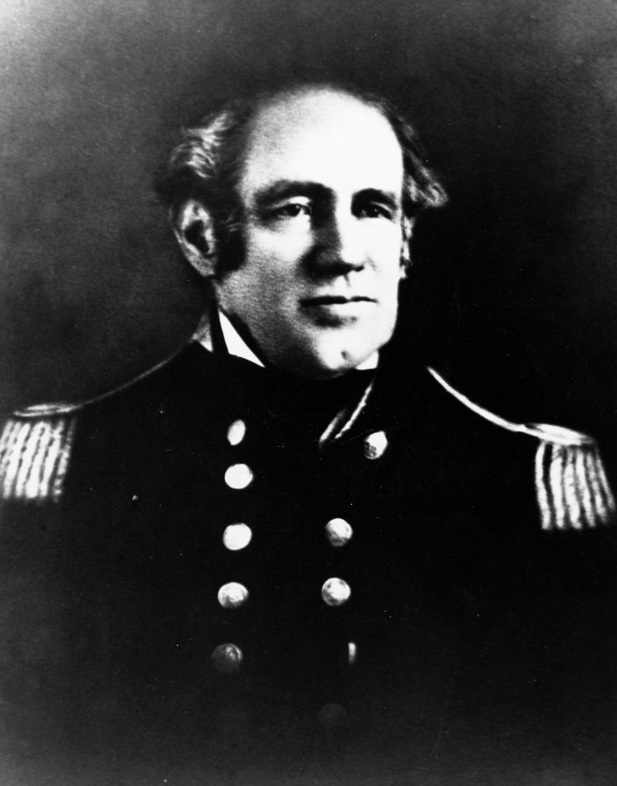

```{r setup}
#devtools::install_github("meflynn/flynnprojects")
#devtools::install_github("MatthewBJane/theme_park")
#devtools::install_github("ropensci/rnaturalearth")
library(tidyverse)
library(ggdag)
library(dagitty)
library(flynnprojects)
#library(ThemePark)
library(ggmap)
library(sf)
library(here)
library(scales)
library(kableExtra)
library(lubridate)
library(rvest)
library(viridis)
library(rnaturalearth)

sysfonts::font_add_google("Oswald", "oswald")
sysfonts::font_add_google("Roboto", "roboto")
showtext::showtext_auto()
showtext::showtext_opts(dpi = 400)


countries <- c("Canada", "United States of America", "Mexico")

base.1 <- ne_countries(scale = 50) |>  
  filter(sovereignt %in% countries)  

# Parameter to reduce compilation time by reducing detail in shapefiles.
detail.reduction <-500

shape.1790 <- sf::read_sf(here("../../../Data Files/NHGIS/nhgis0004_shape/nhgis0004_shape/nhgis0004_shapefile_tl2000_us_state_1790/")) |> 
  mutate(territory = ifelse(grepl(".*erritor.*", STATENAM), "Territory", "State")) |> 
  sf::st_simplify(dTolerance = detail.reduction, preserveTopology = TRUE)


shape.1800 <- sf::read_sf(here("../../../Data Files/NHGIS/nhgis0004_shape/nhgis0004_shape/nhgis0004_shapefile_tl2000_us_state_1800/")) |> 
  mutate(territory = ifelse(grepl(".*erritor.*", STATENAM), "Territory", "State")) |> 
  sf::st_simplify(dTolerance = detail.reduction, preserveTopology = TRUE)


shape.1820 <- sf::read_sf(here("../../../Data Files/NHGIS/nhgis0004_shape/nhgis0004_shape/nhgis0004_shapefile_tl2000_us_state_1820/")) |> 
  mutate(territory = ifelse(grepl(".*erritor.*", STATENAM), "Territory", "State")) |> 
  sf::st_simplify(dTolerance = detail.reduction, preserveTopology = TRUE)


shape.1840 <- sf::read_sf(here("../../../Data Files/NHGIS/nhgis0004_shape/nhgis0004_shape/nhgis0004_shapefile_tl2000_us_state_1840/")) |> 
  mutate(territory = ifelse(grepl(".*erritor.*", STATENAM), "Territory", "State")) |> 
  sf::st_simplify(dTolerance = detail.reduction, preserveTopology = TRUE)


shape.1850 <- sf::read_sf(here("../../../Data Files/NHGIS/nhgis0004_shape/nhgis0005_shape/nhgis0005_shape/nhgis0005_shapefile_tl2000_us_state_1850/")) |> 
  mutate(territory = ifelse(grepl(".*erritor.*", STATENAM), "Territory", "State")) |> 
  sf::st_simplify(dTolerance = detail.reduction, preserveTopology = TRUE)


shape.1860 <- sf::read_sf(here("../../../Data Files/NHGIS/nhgis0004_shape/nhgis0004_shape/nhgis0004_shapefile_tl2000_us_state_1860/")) |> 
  mutate(territory = ifelse(grepl(".*erritor.*", STATENAM), "Territory", "State")) |> 
  sf::st_simplify(dTolerance = detail.reduction, preserveTopology = TRUE)


shape.1900 <- sf::read_sf(here("../../../Data Files/NHGIS/nhgis0004_shape/nhgis0004_shape/nhgis0004_shapefile_tl2000_us_state_1900/")) |> 
  mutate(territory = ifelse(grepl(".*erritor.*", STATENAM), "Territory", "State")) |> 
  sf::st_simplify(dTolerance = detail.reduction, preserveTopology = TRUE)


```


## Lecture Overview

1. Early Years (1783-1870)

2. Transitional Period (1870-1945)

3. Hegemonic Period (1945-2025)

4. Post-Hegemonic Period (2025-Future)


## Key Questions

1. What are the major periods in US foreign policy?

2. What have been some of the key political and economic divides in each time period?

3. What elements of US foreign policy are common across time period? What changes substantially?

4. How do we reconcile the process of US expansion with popular rhetoric about democracy and (more recently) human rights?

5. How does popular historical memory of these earlier time periods shape views on policy today?


## Why do we care?

1. Try to obtain a basic level of descriptive accuracy

2. Find out if reality matches our basic assumption

3. Identify, or rule out, potential causal factors


# The Basics {.inverse}


## The Basics

- US is territorially much, much smaller

- US interactions with other nations were limited

- World is a bigger place

- US had no alliances with other states until the 20th century

- Military was very small  

- Low defense expenditures

- US and global trade were very low through 1970s


## {.blank-slide}


```{r}
#| fig-align: "center"
#| out-width: "70%"

systemdata <- readr::read_csv(here::here("../../../Data Files/COW Data/System/system2011.csv")) %>% 
  group_by(year) %>% 
  dplyr::summarise(Countries = n_distinct(ccode, na.rm = TRUE)) %>% 
  dplyr::rename("Year" = "year")

ggplot(data = systemdata, aes(x = Year, y = Countries)) +
  geom_area(fill = "deepskyblue", color = "black") +
  scale_x_continuous(breaks = seq(1815,2015,15)) +
  labs(x = "Year",
       y = "Count",
       title = "International system size, 1815-2010",
       subtitle = "How does the changing size of the international system affect conflict?",
       caption = "Data obtained from the Correlates of War Project: http://www.correlatesofwar.org/") +
  theme_flynn(base_size = 11, base_family = "oswald") 
```


## {.blank-slide}

```{r military-personnel}
#| fig-align: "center"
#| out-width: "70%"


milper <- read_csv(here("../../../Data Files/COW Data/NMC_5_0/NMC_5_0.csv"))  %>% 
  subset(ccode == 2) %>% 
  mutate(milper.per = milper / tpop)
  
# US military personnel as percent of population
ggplot(data = milper, aes(x = year, y = milper.per)) +
  geom_area(fill = "deepskyblue", color = "black") +
  theme_flynn(base_size = 11, base_family = "oswald") +
  scale_x_continuous(breaks = seq(1815, 2015, 20)) +
  scale_y_continuous(breaks = seq(0, 0.10, 0.02), limits = c(0, 0.10), labels = percent) +
  labs(x = "Year",
       y = "",
       title = "Military personnel as percentage of total population, 1815-2015",
       subtitle = "Historically the US military has been very small, until the Cold War",
       caption = "Data obtained from the Correlates of War Project National Material Capabilities data (v5.0).\nhttp://www.correlatesofwar.org/data-sets/national-material-capabilities")
```


## {.blank-slide}


```{r us-mids}
#| fig-align: "center"
#| out-width: "70%"


middata <- read_csv(here("../../../Data Files/COW Data/MID-level/MIDB_4.01.csv")) %>% 
  mutate(us.mid = as.numeric(ifelse(ccode == 2, 1, 0))) %>% 
  rowwise() %>% 
  mutate(year = list(seq(StYear,EndYear))) %>% 
  ungroup() %>% 
  unnest() %>% 
  group_by(HostLev, year) %>% 
  summarise(midcount = n_distinct(DispNum3), usmidcount = sum(us.mid))
  
mid.time <- tibble(year = seq(1815, 2010)) %>% 
  left_join(middata) %>% 
  mutate(midcount = ifelse(is.na(midcount), 0, midcount),
         usmidcount = ifelse(is.na(usmidcount), 0, usmidcount),
         usmidperc = usmidcount/midcount) %>% 
  pivot_longer(cols = 3:5) %>% 
  filter(!is.na(HostLev))


# US MID count over time
ggplot(data = subset(mid.time, name == "usmidcount"), aes(x = year, y = value)) +
  geom_bar(stat = "identity", color = "black", size = 0.1) +
  theme_flynn(base_size = 11, base_family = "oswald") +
  scale_x_continuous(breaks = seq(1815, 2010, 20)) +
  scale_y_continuous(breaks = seq(0, 12, 2)) +
  labs(x = "Year",
       y = "Count",
       title = "Militarized Interstate Disputes involving the US, 1816-2010",
       subtitle = "What patterns do you see over time?",
       caption = "Data obtained from the Correlates of War Project Militarized Interstate Dispute (v4.01) \n/http://cow.dss.ucdavis.edu/data-sets/MIDs")


```


## {.blank-slide}

```{r map-1790}
#| fig-align: "center"
#| out-width: "70%"


ggplot() +
 geom_sf(data = base.1, fill = "gray80") +
 geom_sf(data = shape.1790, aes(fill = territory)) +
  coord_sf(xlim = c(-170, -50), ylim = c(15, 80)) +
  theme_flynn(base_family = "oswald", base_size = 11) +
  theme(plot.background = element_blank(),
        panel.border =  element_blank(),
        panel.background = element_blank(),
        panel.grid.major = element_blank(),
        panel.grid.minor = element_blank(),
        axis.line.x.bottom = element_blank(),
        axis.line.y.left = element_blank(),
        axis.line = element_blank(),
        axis.ticks = element_blank(),
        axis.text = element_blank()) +
  scale_fill_brewer(palette = "Set1") +
  labs(title = "United States and territories, 1790",
       caption = "Historical shapefiles available from https://data2.nhgis.org/main",
       fill = "Territory\nType")


```


## {.blank-slide}


```{r map-1800}
#| fig-align: "center"
#| out-width: "70%"


ggplot() +
 geom_sf(data = base.1, fill = "gray80") +
 geom_sf(data = shape.1800, aes(fill = territory)) +
  coord_sf(xlim = c(-170, -50), ylim = c(15, 80)) +
  theme_flynn(base_family = "oswald", base_size = 11) +
  theme(plot.background = element_blank(),
        panel.border =  element_blank(),
        panel.background = element_blank(),
        panel.grid.major = element_blank(),
        panel.grid.minor = element_blank(),
        axis.line.x.bottom = element_blank(),
        axis.line.y.left = element_blank(),
        axis.line = element_blank(),
        axis.ticks = element_blank(),
        axis.text = element_blank()) +
  scale_fill_brewer(palette = "Set1") +
  labs(title = "United States and territories, 1800",
       caption = "Historical shapefiles available from https://data2.nhgis.org/main",
       fill = "Territory\nType")


```


## {.blank-slide}


```{r map-1820}
#| fig-align: "center"
#| out-width: "70%"


ggplot() +
 geom_sf(data = base.1, fill = "gray80") +
 geom_sf(data = shape.1820, aes(fill = territory)) +
  coord_sf(xlim = c(-170, -50), ylim = c(15, 80)) +
  theme_flynn(base_family = "oswald", base_size = 11) +
  theme(plot.background = element_blank(),
        panel.border =  element_blank(),
        panel.background = element_blank(),
        panel.grid.major = element_blank(),
        panel.grid.minor = element_blank(),
        axis.line.x.bottom = element_blank(),
        axis.line.y.left = element_blank(),
        axis.line = element_blank(),
        axis.ticks = element_blank(),
        axis.text = element_blank()) +
  scale_fill_brewer(palette = "Set1") +
  labs(title = "United States and territories, 1820",
       caption = "Historical shapefiles available from https://data2.nhgis.org/main",
       fill = "Territory\nType")


```


## {.blank-slide}


```{r map-1840}
#| fig-align: "center"
#| out-width: "70%"


ggplot() +
 geom_sf(data = base.1, fill = "gray80") +
 geom_sf(data = shape.1840, aes(fill = territory)) +
  coord_sf(xlim = c(-170, -50), ylim = c(15, 80)) +
  theme_flynn(base_family = "oswald", base_size = 11) +
  theme(plot.background = element_blank(),
        panel.border =  element_blank(),
        panel.background = element_blank(),
        panel.grid.major = element_blank(),
        panel.grid.minor = element_blank(),
        axis.line.x.bottom = element_blank(),
        axis.line.y.left = element_blank(),
        axis.line = element_blank(),
        axis.ticks = element_blank(),
        axis.text = element_blank()) +
  scale_fill_brewer(palette = "Set1") +
  labs(title = "United States and territories, 1840",
       caption = "Historical shapefiles available from https://data2.nhgis.org/main",
       fill = "Territory\nType")


```


## {.blank-slide}


```{r map-1850}
#| fig-align: "center"
#| out-width: "70%"


ggplot() +
 geom_sf(data = base.1, fill = "gray80") +
 geom_sf(data = shape.1850, aes(fill = territory)) +
  coord_sf(xlim = c(-170, -50), ylim = c(15, 80)) +
  theme_flynn(base_family = "oswald", base_size = 11) +
  theme(plot.background = element_blank(),
        panel.border =  element_blank(),
        panel.background = element_blank(),
        panel.grid.major = element_blank(),
        panel.grid.minor = element_blank(),
        axis.line.x.bottom = element_blank(),
        axis.line.y.left = element_blank(),
        axis.line = element_blank(),
        axis.ticks = element_blank(),
        axis.text = element_blank()) +
  scale_fill_brewer(palette = "Set1") +
  labs(title = "United States and territories, 1850",
       caption = "Historical shapefiles available from https://data2.nhgis.org/main",
       fill = "Territory\nType")


```


## {.blank-slide}


```{r map-1860}
#| fig-align: "center"
#| out-width: "70%"


ggplot() +
 geom_sf(data = base.1, fill = "gray80") +
 geom_sf(data = shape.1860, aes(fill = territory)) +
  coord_sf(xlim = c(-170, -50), ylim = c(15, 80)) +
  theme_flynn(base_family = "oswald", base_size = 11) +
  theme(plot.background = element_blank(),
        panel.border =  element_blank(),
        panel.background = element_blank(),
        panel.grid.major = element_blank(),
        panel.grid.minor = element_blank(),
        axis.line.x.bottom = element_blank(),
        axis.line.y.left = element_blank(),
        axis.line = element_blank(),
        axis.ticks = element_blank(),
        axis.text = element_blank()) +
  scale_fill_brewer(palette = "Set1") +
  labs(title = "United States and territories, 1860",
       caption = "Historical shapefiles available from https://data2.nhgis.org/main",
       fill = "Territory\nType")


```


## {.blank-slide}


```{r map-1900}
#| fig-align: "center"
#| out-width: "70%"

ggplot() +
 geom_sf(data = base.1, fill = "gray80") +
 geom_sf(data = shape.1900, aes(fill = territory)) +
  coord_sf(xlim = c(-170, -50), ylim = c(15, 80)) +
  theme_flynn(base_family = "oswald", base_size = 11) +
  theme(plot.background = element_blank(),
        panel.border =  element_blank(),
        panel.background = element_blank(),
        panel.grid.major = element_blank(),
        panel.grid.minor = element_blank(),
        axis.line.x.bottom = element_blank(),
        axis.line.y.left = element_blank(),
        axis.line = element_blank(),
        axis.ticks = element_blank(),
        axis.text = element_blank()) +
  scale_fill_brewer(palette = "Set1") +
  labs(title = "United States and territories, 1900",
       caption = "Historical shapefiles available from https://data2.nhgis.org/main",
       fill = "Territory\nType")


```


## {.blank-slide}


```{r army-campaigns}
#| fig-align: "center"
#| out-width: "70%"

campaign <- readxl::read_xls(here("../../../my-courses/POLSC 343 American Foreign Policy/Data/US military campaigns.xls")) %>% 
  arrange(WarAndTheater_Ed196_, BattleOrCampaign_Ed197_)

duration.data <- campaign %>% 
  arrange(., WarAndTheater_Ed196_, BattleOrCampaign_Ed197_) %>% 
  mutate(WarAndTheater_Ed196_ = ifelse(is.na(WarAndTheater_Ed196_), BattleOrCampaign_Ed197_, WarAndTheater_Ed196_),
         WarAndTheater_Ed196_ = ifelse(WarAndTheater_Ed196_ == "WorldWar II: Asia-Pacific", "World War II: Asia-Pacific", WarAndTheater_Ed196_),
    `Year...1` = ifelse(BattleOrCampaign_Ed197_ == "Comanches" |
                              BattleOrCampaign_Ed197_ == "Modocs" |
                              BattleOrCampaign_Ed197_ == "Apaches" |
                              BattleOrCampaign_Ed197_ == "Little Big Horn" |
                              BattleOrCampaign_Ed197_ == "Nez Perces" |
                              BattleOrCampaign_Ed197_ == "Bannocks" |
                              BattleOrCampaign_Ed197_ == "Cheyennes",
                              paste("Jan", "01", `Year...1`, sep = "-"),
                              `Year...1`),
         `Year...2` = ifelse(BattleOrCampaign_Ed197_ == "Comanches" |
                         BattleOrCampaign_Ed197_ == "Modocs" |
                         BattleOrCampaign_Ed197_ == "Apaches" |
                         BattleOrCampaign_Ed197_ == "Little Big Horn" |
                         BattleOrCampaign_Ed197_ == "Nez Perces" |
                         BattleOrCampaign_Ed197_ == "Bannocks" |
                         BattleOrCampaign_Ed197_ == "Cheyennes",
                       paste("Jan", "01", `Year...2`, sep = "-"),
                       `Year...2`),
         `Year...1` = ifelse(BattleOrCampaign_Ed197_ == "Creek", "Feb 18, 1836", `Year...1`),
         `Year...2` = ifelse(BattleOrCampaign_Ed197_ == "Creek", "Feb 18, 1836", `Year...2`),
         `Year...1` = ifelse(BattleOrCampaign_Ed197_ == "Miami", "Jan 1, 1790", `Year...1`),
         `Year...2` = ifelse(BattleOrCampaign_Ed197_ == "Miami", "Aug 1, 1795", `Year...2`),
         `Year...1` = ifelse(BattleOrCampaign_Ed197_ == "Utes", "Sep 1, 1879", `Year...1`),
         `Year...2` = ifelse(BattleOrCampaign_Ed197_ == "Utes", "Nov 1, 1880", `Year...2`),
         `Year...1` = ifelse(BattleOrCampaign_Ed197_ == "Pine Ridge", "Nov 1, 1890", `Year...1`),
         `Year...2` = ifelse(BattleOrCampaign_Ed197_ == "Pine Ridge", "Jan 1, 1891", `Year...2`),
         `Year...2` = ifelse(BattleOrCampaign_Ed197_ == "Seminole" & `Year...1` == "Nov 20, 1817", "Oct 31, 1818", `Year...2`),
         `Year...2` = ifelse(BattleOrCampaign_Ed197_ == "Seminole" & `Year...1` == "Dec 28, 1835", "Aug 14, 1842", `Year...2`),
         `Year...2` = ifelse(BattleOrCampaign_Ed197_ == "Seminole" & `Year...1` == "Dec 15, 1855", "May 1, 1858", `Year...2`),
         startyear = lubridate::mdy(`Year...1`),
         endyear = lubridate::mdy(`Year...2`),
    startyear = as.Date(startyear),
    endyear = as.Date(endyear),
    totalduration = ifelse(endyear - startyear == 0, endyear - startyear + 1, endyear - startyear)) %>% 
  arrange(WarAndTheater_Ed196_, BattleOrCampaign_Ed197_) %>% 
  group_by(WarAndTheater_Ed196_) 

# Plotting campaign phases over time and by conflict
ggplot(data = duration.data, aes(y = reorder(WarAndTheater_Ed196_, startyear), x = startyear, group = WarAndTheater_Ed196_, colour = BattleOrCampaign_Ed197_)) +
  geom_segment(aes(xend = endyear, yend = WarAndTheater_Ed196_), linewidth = 7) +
  theme_flynn(base_size = 11, base_family = "oswald") +
  guides(colour = FALSE) +
  viridis::scale_color_viridis(discrete = TRUE) +
  labs(x = "Time",
       y = "",
       title = "US Army campaigns grouped by major war/theater",
       caption = "Data obtained from: Historical Statistics of the United States, Table Ed196-197 - U.S. Army battle campaigns: 1775–1995 \nBattle campaigns are denoted by official military medals and streamers. Data updated through 2025 manually.")


```


## {.blank-slide}

```{r army-campaign-duration-2}
#| fig-align: "center"
#| out-width: "70%"

# Plotting total duration by conflict
ggplot(data = duration.data, aes(y = reorder(WarAndTheater_Ed196_, startyear), 
                            x = totalduration, 
                            group = WarAndTheater_Ed196_, 
                            fill = BattleOrCampaign_Ed197_)
       ) +
  geom_bar(stat = "identity") +
  theme_flynn(base_size = 11, base_family = "oswald") +
  guides(fill = FALSE) +
  scale_x_continuous(breaks = seq(0, 12000, 2000), limits = c(0,12000)) +
  viridis::scale_fill_viridis(discrete = TRUE) +
  labs(y = "",
       x = "Days",
       title = "US Army campaign duration in days",
       caption = "Data obtained from: Historical Statistics of the United States, Table Ed196-197 - U.S. Army battle campaigns: 1775–1995 \nBattle campaigns are denoted by official military medals and streamers.") 

```


# The Early Years {.inverse}


## The Early Years

- Treaty of Paris: September 3, 1783

- Officially ends war with Great Britain

- Freedom!


## The Early Years

::::{.columns}
:::{.column width=50%}
- Treaty of Paris: September 3, 1783

- Officially ends war with Great Britain

- Freedom!

- But there were new enemies...DUN DUN DUN!
:::

:::{.column width=50%}
```{r}
knitr::include_graphics("https://jollycontrarian.com/images/a/ab/Dramatic_Look_Gopher.gif")
```
:::
::::


## The Early Years

- America still relatively weak 

- Small population, no military, not economically developed/diversified

- Still vulnerable to attack and economic exploitation

- Key Conflicts:

  - Managing relations with major powers

  - English and Spanish territories in Canada and Florida

  - Territorial conflicts with Native Americans on frontier 

  - Access to the Mississippi

  - Access to foreign markets and shipping rights
  
  


## The Early Years

> **Mercantilism**: An economic doctrine based on a belief that military power and economic influence complemented each other; applied especially to colonial empires in the sixteenth through eighteenth centuries. Mercantilist policies favored the mother country over its colonies and over its competitors. Frieden, Lake, and Schultz p. A-4.

> Zero-sum game: The idea that for one player or group to gain something another player or group must lose something. 

  
## The Early Years

::::{.columns}
:::{.column width=50%}
*Washington's Farewell Address:*

> The great rule of conduct for us, in regard to foreign nations, is, in extending our commercial relations, to have with them as little political connexion [sic] as possible. So far as we have already formed engagements, let them be fulfilled with perfect good faith. Here let us stop.

:::

:::{.column width=50%}
{fig-align="center"}
:::
::::

  


## The Early Years

::::{.columns}

:::{.column width=50%}
{height=5.75in fig-align="center"}
:::

:::{.column width=50%}
{height=5.75in fig-align="center"}
:::
::::


## The Early Years

::::{.columns}

:::{.column width=50%}
{height=5.75in fig-align="center"}
:::

:::{.column width=50%}
{height=5.75in fig-align="center"}
:::
::::

:::{.notes}

- France had ambitions to reconquer parts of North America. But the slave revolt in Haiti during the 1790s and Napoleon's defeat in Europe made this impossible.

- The Louisiana Purchase arises from Napoleon's desire to secure financing for his wars in Europe. The US was able to purchase the territory for \$15 million. This is about \$229 million in today's dollars.

- Livingston is US minister to France. He's charged with negotiating the purchase of New Orleans and West Florida. He ends up negotiating the purchase of the entire Louisiana Territory. Notably he exceeded his authority, and President Jefferson at the time opted to ask forgiveness rather than permission from Congress. 

- The War of 1812 is ultimately a side conflict of the Napoleonic Wars. The US is fighting Britain, but Britain is fighting France. The US is also fighting Native Americans who are fighting the US and Britain.

- Jefferson also dispatches Marines to work with mercenaries and local fighters to fight pirates on the Barbary coast. 

- Ultimately this early time period solidifies the US' status as a regional power and mostly secures its borders, though British forces did invade Washington DC and burn the White House in 1814.

- Monroe Doctrine follows from these conflicts. It's an attempt to keep European powers out of the Western Hemisphere. But the US can't enforce it so it largely relies on Britain.
::: 


## The Early Years

### The Monroe Doctrine

- Laid out by President James Monroe in 1823 

- A response to European efforts to re-establish monarchical governments or colonies in the Western Hemisphere

- Also spurred on by conflict with Russia over Northwestern territories

- Asserts the US will continue to respect sovereignty of European governments

- Also says that any attempt by European governments to interfere in Western Hemisphere will be regarded as a threat to US security and interests. 


:::{.notes}

Monroe Doctrine excerpt

We owe it, therefore, to candor and to the amicable relations existing between the United States and those powers to declare that we should consider any attempt on their part to extend their system to any portion of this hemisphere as dangerous to our peace and safety. With the existing colonies or dependencies of any European power we have not interfered and shall not interfere. But with the Governments who have declared their independence and maintain it, and whose independence we have, on great consideration and on just principles, acknowledged, we could not view any interposition for the purpose of oppressing them, or controlling in any other manner their destiny, by any European power in any other light than as the manifestation of an unfriendly disposition toward the United States. In the war between those new Governments and Spain we declared our neutrality at the time of their recognition, and to this we have adhered, and shall continue to adhere, provided no change shall occur which, in the judgement of the competent authorities of this Government, shall make a corresponding change on the part of the United States indispensable to their security.

:::


## The Early Years

### Slave Trade

- A major issue that tied into conflicts over expansion and foreign relations

- British abolish slave **trade** within the Empire in 1807

- It's not until 1830s and 1840s that **most** enslaved peoples are actually freed within the British Empire

- But early British efforts to police the Trans-Atlantic Slave Trade lead to conflict with the United States

- Expansion into Western territories also exacerbates domestic conflicts over slavery

:::{.notes}
 Notes
 
 - 1807 Slave Trade Act prohibits the buying and selling of people within the Empire.
 
 - US outlaws international slave trade in 1808
 
 - Slavery Abolition Act of 1833 ends slavery for **most** enslaved peoples within the Empire.
 
 - Congress relaxed restrictions on slavery in 1804 and 1805 to help promote migration into the Louisiana Purchase, and also to ward off threats from settlers that they would reach out to Napoleon if the US continued to try to crack down on slavery. 
 
 - Slavers raise US flag on their ships to try to avoid British inspections, but British Navy begins boarding US flagged ships at sea to locate people who are still attempting to enslave, or buy and sell, people. 
 
 - Creole Mutiny:  In 1841 a US slave ship traveling down the coast with 135 enslaved African-Americans headed for New Orleans. 18 of the Enslaved passengers revolted. One slave trader and one of the enslaved individuals died. They then directed the ship to the Bahamas, a British colony, where they would be set free. Incidents like these caused tensions between the US and Britain as there was no extradition agreement at the time. 

:::


## The Early Years

### The Nullification Crisis

- Tariffs represent a major source of conflict in the early US

- New tariffs passed in 1828 and 1832

- Tariffs affect different segments of the population...differently

- Conflict over tariffs for revenue vs tariffs for protection

- South Carolina state convention adopts Ordinance of Nullification in 1832

- President Jackson threatens to send troops to enforce the tariffs

:::{.notes}
- The split is largely along North/South lines.

- South Carolina believes that the tariffs are unfairly targeting them and that they have the right to nullify federal laws that they believe are unconstitutional (but courts have repeatedly struck down nullification). 

- President Jackson threatens to send troops to enforce the tariffs. Congress passes a compromise tariff in 1833 that lowers rates over time. South Carolina repeals the Ordinance of Nullification but also passes a new ordinance nullifying the Force Act, which allows the president to use force to enforce federal laws.
:::


## The Early Years

::::{.columns}
:::{.column width=50%}
### The Aroostook War (aka the Pork and Beans War)

- The border between Maine and Canada/New Brunswick was disputed.

- Canadian loggers entered the territory, evoking the anger of American counterparts

- No actual fighting, though military forces on both sides were mobilized. 

:::

:::{.column width=50%}
{width=90%}

:::

::::


## The Early Years

### Mexican–American War (1846--1848)

- Southwest territory is attractive for several reasons

- California has valuable ports for commerce with Asia

- Texas presents opportunities for new land and territory

- Both territories are viewed as helpful in defending against European aggression

::: {.notes}
Mexican-American War

- Mexico achieves independence in 1821

- Texas becomes a state in newly free Mexico after Mexican war for independence. Politically weak, sparsely populated, and vulnerable to attacks due to vast border and small military presence.

- Mexico initially welcomes immigration into the new state to help stabilize it and control the territory.

- By 1835 35,000 Americans and 5,000 slaves have moved into Texas.

- Mexico starts to exert more control and seeks to abolish slavery.

- Texas declares it's seceding from Mexico and fights war known as the Texas Revolution in 1835-1836.

- Texas initially independent. Britain and France liket his as it presents a check against the US. They don't want the US to get bigger and more powerful through annexation of Texas.

- In 1845 Congress passes a joint resolution by simple majority to admit Texas as a state. 

- Admission is a source of conflict. Southern states view it as essential for supporting slavery. Abolitionists fear that Southerners will use it to perpetuate slavery and their control over government. 

- See Herring 2008, 190s.

:::


## The Early Years

### Capture of Monterey (1842)

::::{.columns}
:::{.column width=50%}
- Tensions between United States and Mexico were high before the Mexican--American War erupted in 1846

- Capture of Monterey in 1842

- US Navy Commodore Thomas Catesby decided to act on rumors that US and Mexico were at war

- Upon realizing that the US and Mexico were *not* at war, Catesby apologized, returend the fort to Mexican troops, held a banquet for the garrison, and sailed away.
:::

:::{.column width=50%}

{align="center" width=70%}
:::
::::

:::{.notes}

Notes

- Communications are hard! 

- Delegating power to commanders is risky. They can improvise where needed, but they might also spark an international incident!

:::


## The Early Years

### Manifest Destiny

- The term is attributed to John L. O'Sullivan in 1845

- A succinct way of saying that America's westward expansion was clearly and divinely mandated.

- Deployed in different ways by different coalitions, but ultimately used as a slogan to justify various policies associated with Westward expansion. 


## The Early Years

### Civil War

- North-South split very deep (slavery, economics, expansion, trade, etc)

- In reality, these are all very closely connected

- Economic interests of the North and South were fundamentally different


## The Early Years

### Civil War: International Dimension

- European attitudes are mixed (oppose slavery, but want weak America)

- Some British politicians supported the North, but many favored the South in an effort to keep the United States divided

- Weakened United States would pose less of a threat to British hegemony

- Independent Southern states would change dynamics of international trade in Britain’s favor


# Transition {.inverse}


## Transition

- US emerges from Civil War as a major power

- US economy grows rapidly, surpassing Great Britain somewhere in the 1870s

- Policymakers start thinking about the US' role in the broader world

- Attention turns to acquiring overseas territories (i.e. colonies)

- The Spanish American War presents the first opportunities for the US to acquire overseas territories

- Spain loses; US walks away with the Philippines, Guam, Puerto Rico, and Cuba (sort of)


## Transition

Supporters of expansion cite:

- Need for a strong navy
- Economy benefits and secure trade markets
- National pride
- Monroe Doctrine
- Religion

Opponents of expansion cite:

- History
- Washington's Farewell Address
- Costs of empire
- Monroe Doctrine
- Religion


## {.blank-slide}


```{r milspend-1800s}
#| fig-align: "center"
#| out-width: "70%"


# Note: Use gsub command inside mutate wrapper.
spend <- read_csv(here("../../../Data Files/Historical Statistics of the United States/TableEa636-643/Ea636-643.csv"), skip = 7)  %>% 
  dplyr::rename("Year" = 1, "spend.fed" = 3, "spend.def" = 4, "spend.army" = 6, "spend.navy" = 7, "spend.vet" = 11) %>% 
  mutate(spend.navy = as.numeric(gsub("\\D", "", spend.navy)),
         spend.fed = as.numeric(paste(gsub("\\D", "", spend.fed))),
         spend.army = as.numeric(paste(gsub("\\D", "", spend.army))),
         spend.vet = as.numeric(gsub("\\D", "", spend.vet)),
         spend.def = as.numeric(paste(gsub("\\D", "", spend.def))),
         army.per = spend.army/spend.fed,
         navy.per = spend.navy/spend.fed,
         vet.per = spend.vet/spend.fed) %>% 
  subset(!is.na(Year)) %>% 
  select(c(1, 3, 4, 6, 7, 11, 12, 13, 14)) %>% 
  pivot_longer(cols = c(2:9),
               names_to = "group",
               values_to = "value")


#Navy, Army, and Veterans' spending 1870-1914 (constant dollars)
ggplot(data = subset(spend, Year >= 1870 & Year <= 1914 & group == "spend.navy" | 
                       Year >= 1870 & Year <= 1914 & group == "spend.army" |
                       Year >= 1870 & Year <= 1914 & group == "spend.vet"), aes(x = Year, y = value, fill = group)) +
  geom_area(position = "stack", color = "black", size = .1) +
  theme_flynn(base_size = 11, base_family = "oswald") +
  scale_fill_brewer(labels = c("Army", "Navy", "Veterans"),
                    palette = "Spectral") +
  scale_x_continuous(breaks = seq(1870, 1915, 5)) +
  scale_y_continuous(labels = dollar) +
  labs(y = "Thousands of current dollars",
       fill = "Category",
       title = "Military and veterans' spending, 1870-1914",
       subtitle = "Period between the Civil War and World War I sees big changes in US military spending",
       caption = "Data obtained from Historical Statistics of the United States. \nhttps://hsus-cambridge-org.proxy.binghamton.edu/HSUSWeb/toc/tableToc.do?id=Ea636-643")
```


## {.blank-slide}


```{r milspend-1800s-2}
#| fig-align: "center"
#| out-width: "70%"

#Navy, Army, and Veterans' spending 1870-1914 (percent federal spending)
ggplot(data = subset(spend, Year >= 1870 & Year <= 1914 & group == "navy.per" | 
                       Year >= 1870 & Year <= 1914 & group == "army.per" |
                       Year >= 1870 & Year <= 1914 & group == "vet.per"), aes(x = Year, y = value, fill = group)) +
  geom_area(position = "stack", color = "black", size = .1) +
  theme_flynn(base_size = 11, base_family = "oswald") +
  scale_fill_brewer(labels = c("Army", "Navy", "Veterans"),
                    palette = "Spectral") +
  scale_x_continuous(breaks = seq(1870, 1915, 5)) +
  scale_y_continuous(breaks = seq(0, 1, .2), limits = c(0,1), labels = percent) +
  labs(y = "",
       fill = "Category",
       title = "Military and veterans' spending as percentage of federal spending, 1870-1914",
       subtitle = "Period between the Civil War and World War I sees big changes in US military spending",
       caption = "Data obtained from Historical Statistics of the United States. \nhttps://hsus-cambridge-org.proxy.binghamton.edu/HSUSWeb/toc/tableToc.do?id=Ea636-643")

```


# Rise to Great Power Status {.inverse}


## Rise to Great Power Status

### World War I

United States enters the war in 1917

- Initially neutral

- German submarine warfare targets American merchant shipping

- Sinking of the Lusitania

- Stalemate in Europe as war drags on


## Rise to Great Power Status

Consequences of the war:
  
  - Breakdown of old imperial powers
  - Austo-Hungarian Empire collapses
  - Ottoman Empire collapses 
  - German Empire defeated
  - Creation of several new states
  - Nationalism as a driving force in European politics
  - Partition of Middle East
  - Russian Revolution
  - US rejects global leadership role
  - New forms of warfare emerge
  - League of Nations created
  - Reparations imposed on Germany
  - Turkey stripped of territory, resources


## {.blank-slide}

```{r system-size}
#| fig-align: "center"
#| out-width: "70%"

ggplot(data = systemdata, aes(x = Year, y = Countries)) +
  geom_area(fill = "deepskyblue", color = "black", linewidth = 0.1) +
  scale_x_continuous(breaks = seq(1815,2015,15)) +
  labs(x = "Year",
       y = "Count",
       title = "International system size, 1815-2010",
       subtitle = "How does the changing size of the international system affect conflict?",
       caption = "Data obtained from the Correlates of War Project: http://www.correlatesofwar.org/") +
  theme_flynn(base_size = 11, base_family = "oswald")  +
  annotate("segment", x = 1920, xend = 1920, y = 125, yend = 65, size = 2, arrow=arrow(), color = "red")
```


## Rise to Great Power Status

Treaty of Versailles

- Often viewed as unfair/unreasonable

- France aimed to punish Germany

- Severe reparations imposed on Germany

- Industrial resources seized

- US Senate rejects Treaty of Versailles Twice


League of Nations: 

- Viewed as a contrast to previous international orders

- Provides for collective security

- Emphasizes self-determination

- Free trade

:::{.notes}
US and League
- President Wilson (a Democrat) supports a more international role for US

- Many Republicans oppose the League and the treaty as written (The Irreconcilables)

- But some prominent Republicans support it (Henry Stimson)

- Debates over US involvement continue throughout the 1920s

- Senate Republicans repeatedly object to participating in League organizations like the International Court of Justice.
:::


## {.blank-slide}

::::{.columns}
:::{.column width=50%}
{width=70% fig-align="center"}
:::
:::{.column width=50%}
{width=70% fig-align="center"}
:::
::::


## {.blank-slide}


```{r warning=FALSE}
#| fig-align: "center"
#| out-width: "70%"

trade <- read_csv(here("../../../Data Files/COW Data/COW_Trade_4.0/National_COW_4.0.csv")) %>% 
  group_by(year) %>% 
  summarise(imports = sum(imports, na.rm = TRUE), 
            exports = sum(exports, na.rm = TRUE), 
            totaltrade = (imports+exports))

ggplot(data = subset(trade, year >= 1900 & year <= 1940), aes(x = year, y = totaltrade)) +
  geom_area(fill = "deepskyblue", color = "black", size = 0.1, alpha = .9) +
  theme_flynn(base_size = 11, base_family = "oswald") +
  scale_x_continuous(breaks = seq(1900, 1940, 5)) +
  scale_y_continuous(breaks = seq(0, 70000, 10000), labels = dollar) +
  labs(title = "Global trade volume, 1900-1940",
       x = "Year",
       y = "Millions of current dollars",
       caption = "Data obtained from Correlates of War Data National Trade Data (v4.0)")


```


## {.blank-slide}


```{r warning=FALSE}
#| fig-align: "center"
#| out-width: "70%"


us.trade <- read_csv(here("../../../Data Files/COW Data/COW_Trade_4.0/National_COW_4.0.csv")) %>% 
  subset(ccode == 2) %>% 
  group_by(year) %>% 
  summarise(imports = sum(imports, na.rm = TRUE), 
            exports = sum(exports, na.rm = TRUE), 
            totaltrade = (imports+exports))

ggplot(data = us.trade, aes(x = year, y = exports)) +
  geom_area(fill = "deepskyblue", color = "black", size = 0.1, alpha = .9) +
  theme_flynn(base_size = 11, base_family = "oswald") +
  scale_x_continuous(breaks = seq(1900, 1950, 5), limits = c(1900, 1950)) +
  scale_y_continuous(breaks = seq(0, 15000, 3000), labels = dollar) +
  labs(title = "US export volume, 1900-1950",
       x = "Year",
       y = "Millions of current dollars",
       caption = "Data obtained from Correlates of War Data National Trade Data (v4.0)")


```


## {.blank-slide}


```{r us-gnp}
#| fig-align: "center"
#| out-width: "70%"


gnp <- read.delim(here("../../../Data Files/NBER/GDP/a08166.dat.txt"), sep = " ", header = FALSE) %>% 
  subset(select = c("V1", "V4")) %>% 
  plyr::rename(c("V1" = "Year", "V4" = "GNP")) %>% 
  mutate(gnp.change = (GNP - lag(GNP)) / lag(GNP),
         growth = as.factor(ifelse(gnp.change > 0, 1, 0)))


ggplot(data = gnp, aes(x = Year, y = GNP)) +
  geom_bar(fill = "deepskyblue", color = "black", size = 0.1, stat = "identity") +
  theme_flynn(base_size = 11, base_family = "oswald") +
  scale_x_continuous(breaks = seq(1920, 1950, 5), limits = c(1919, 1951)) +
  scale_y_continuous(breaks = seq(0, 175000, 25000), labels = dollar) +
  labs(y = "Millions of 1929 dollars",
       title = "US gross national product, 1920-1950",
       subtitle = "What trends or changes do you see near key events?",
       caption = "Data obtained from: http://www.nber.org/databases/macrohistory/rectdata/08/a08166.dat")


```


## {.blank-slide}


```{r us-gnp-growth}
#| fig-align: "center"
#| out-width: "70%"


# US GNP change by year
ggplot(data = gnp, aes(x = Year, y = gnp.change, group = growth, fill = stat(gnp$gnp.change >0))) +
  geom_bar(stat = "identity", color = "black", size = 0.1) +
  geom_hline(yintercept = 0, color = "black", size = .3) +
  theme_flynn(base_size = 11, base_family = "oswald") +
  scale_x_continuous(breaks = seq(1920, 1950, 5), limits = c(1919, 1951)) +
  scale_y_continuous(breaks = seq(-0.15, 0.15, 0.05), labels = percent) +
  scale_fill_brewer(palette = "Set1") +
  labs(y = "Growth rate",
       title = "US Gross national product growth, 1920-1950",
       subtitle = "Note the patterns in growth in the 1930s and early 1940s",
       caption = "Data obtained from: http://www.nber.org/databases/macrohistory/rectdata/08/a08166.dat") +
  guides(fill = FALSE)


```


## {.blank-slide}


```{r unemployment}
#| fig-align: "center"
#| out-width: "70%"


unemp <- read.delim(here("../../../Data Files/NBER/Unemployment/m08292a.dat.txt"), sep = "", header = FALSE) %>% 
 rename(c("Year" = "V1","Period" = "V2","Rate" = "V3")) %>% 
  mutate(Rate = as.numeric(gsub("[^.[0-9]]", "", Rate)),
         Time = as.Date(paste(Year, Period, "01", sep = "-"), format = '%Y-%m-%d'),
         change = Rate - dplyr::lag(Rate, order_by = Time))

# US unemployment rate
ggplot(data = unemp, aes(x = Time, y = Rate/100)) +
  geom_line(size = 0.75) +
  theme_flynn(base_size = 11, base_family = "oswald") +
  scale_x_date(breaks = seq(as.Date("1930-01-01"), as.Date("1942-01-01"), "2 years"), limits = c(as.Date("1930-01-01"), as.Date("1942-01-01")), date_labels = "%Y %b") +
  scale_y_continuous(breaks = seq(0, 0.25, 0.05), labels = percent) +
  labs(y = "",
       title = "US monthly unemployment rate, 1930-1941",
       subtitle = "What trends or changes do you see near key events?",
       caption = "Data obtained from: http://www.nber.org/databases/macrohistory/rectdata/08/docs/m08292a.txt")


```


## {.blank-slide}

```{r}
#| fig-align: "center"
#| out-width: "70%"


ggplot(data = unemp, aes(x = Time, y = change, color = change)) +
  geom_line(size = 1.0) +
  geom_hline(yintercept = 0, color = "black", size = 1.0) +
  theme_flynn(base_size = 11, base_family = "oswald") +
  scale_x_date(breaks = seq(as.Date("1930-01-01"), as.Date("1942-01-01"), "2 years"), limits = c(as.Date("1930-01-01"), as.Date("1942-01-01")), date_labels = "%Y %b") +
  guides(color = FALSE) +
  scale_y_continuous(breaks = seq(-3, 3, 1), labels = comma_format()) +
  scale_color_gradient2(low = "green3", mid = "yellow3", high = "red3",  midpoint = 0) +
  labs(y = "",
       title = "Percentage point change in US monthly unemployment rate, 1930-1941",
       subtitle = "What trends or changes do you see near key events?",
       caption = "Data obtained from: http://www.nber.org/databases/macrohistory/rectdata/08/docs/m08292a.txt")


```


## Rise to Great Power Status

### German domesic politics

- Germany recovering from initial economic woes, but hit hard by the depression

- Radical political parties benefit from economic crisis

- Hitler rises to power in 1933


## Rise to Great Power Status

### German foreign policy actions

- Germany, Italy, and Japan sign a series of treaties between 1936 and 1937

- March 1938 Germany annexes Austria by "request"

- September 1938 Germany annexes Sudentenland (part of Czechoslovakia)


## Rise to Great Power Status

### Steps to war

- September 3, 1939 Germany invades Poland

- British and French declare war by day's end

- By July 1940 France falls to Germany forces

- Battle of Britain begins in August 1940


## Rise to Great Power Status

### Japanese foreign policy actions

- Japanese military occupied Manchuria in 1931

- Extends control of China through early 1940s

- Japanese seeking to secure access to materials like oil and rubber

- Expansion brings Japan into conflict with Western powers throughout the Pacific


## {.blank-slide}

```{r}

resources <- tibble(Resource = c("Steel", "Nickel", "Aluminum", "Iron Ore", "Oil"),
                    Percent = c("40%", "100%", "60%", "85%", "80%"))

kable(resources, 
      'html', 
      align = c("l", "r"),
      caption = c("Japanese imports of raw materials as percentage of consumption")) %>%
   kable_styling(full_width = TRUE) %>% 
   column_spec(1, width_min = "5cm") %>% 
   row_spec(0, bold = T, color = "white", background = "#512888") %>% 
   footnote(general = "Data obtained from John Keegan. The Second World War.",
           footnote_as_chunk = TRUE, title_format = c("italic"))
  

```


## Rise to Great Power Status

### The US in the 1930s

- US resists-ish steps to mobilize for war

- Congress imposes arms embargo on belligerent nations

- Congress passes Neutrality Acts 1935-1939

- December 7, 1941 Japanese bomb Pearl Harbor naval base
